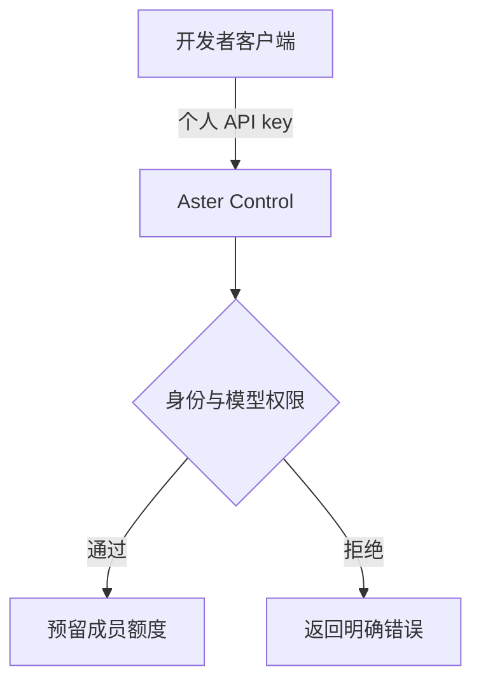
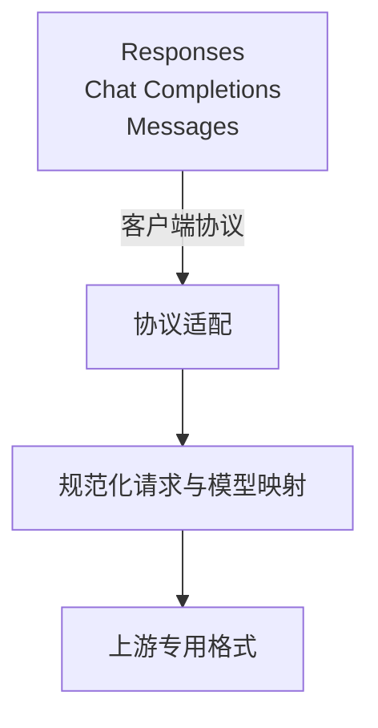
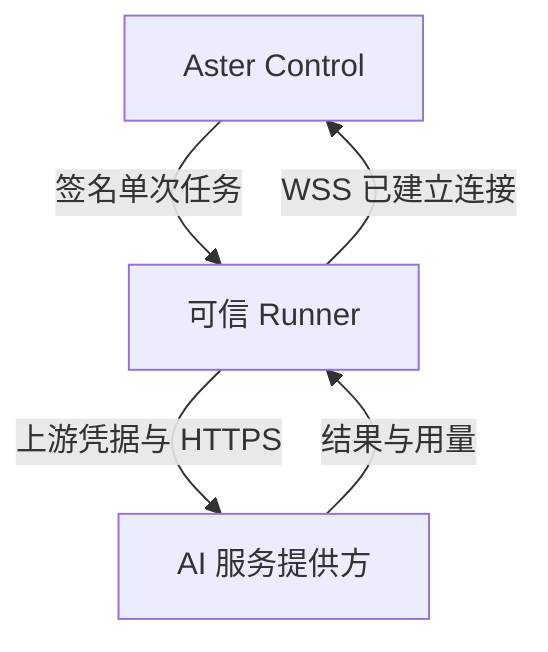
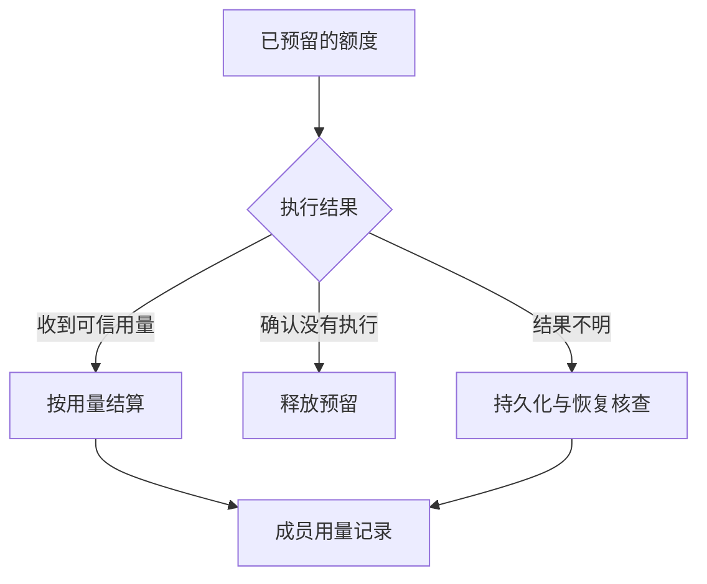
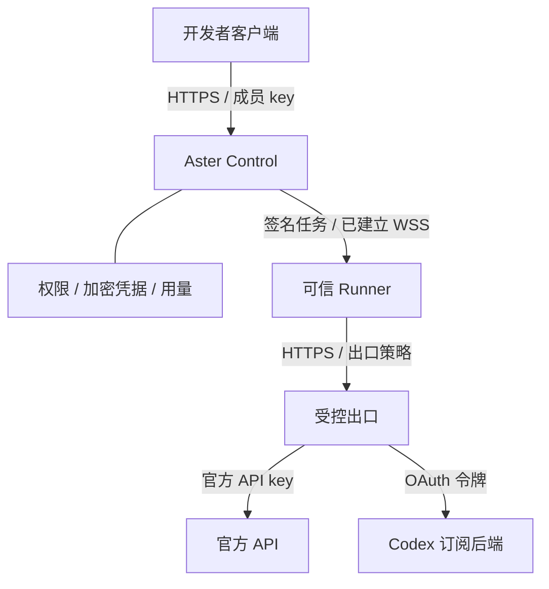

# Aster Team research and diagram sources

Reviewed on 2026-10-12. Subject: `huzz-open/aster-team`. Following the user's editorial clarification, the article treats this project directly and omits project-identification discussion and same-name alternatives.

## Scope and evidence

Outcome: one Chinese distilled article explaining the subscription gateway, its request lifecycle, and its practical limits. Ownership: the new post and its diagrams. No shared components, runtime dependencies, account configuration, deployment, or upstream requests are changed.

Source checkout: `ff9d58cd5fd04dd4e6bae9e75cda7e4ad92655e3` (2026-09-29). GitHub API reported repository creation on 2026-09-14 and release `v2.1.1` on 2026-09-16, with Linux amd64 and Windows amd64 packages. Source and release package behavior must not be treated as identical without testing.

The following source documents were read and inventoried. Each is used in the article; overlapping sections are consolidated rather than reproduced in source order.

| Primary document under the Aster repository | Coverage in article |
| --- | --- |
| `README.md` | Product identity and current distribution |
| `docs/architecture.md` | Control, Runner, credential boundary, task integrity, routing, audit, network |
| `docs/api-reference.md` | Endpoints, authentication, variants, errors, streaming/retries |
| `docs/getting-started.md` | Platform packages, verification, installation, interfaces, first request |
| `docs/service-boundaries.md` | Accounts, charges, network, availability, authorization |
| `docs/guides/codex-authentication-comparison.md` | Three credential and entitlement paths |
| `docs/guides/configure-codex-api-key.md` | Custom provider configuration and compatibility marker |
| `docs/guides/multiple-independent-codex-clients.md` | Independent member access versus shared upstream capacity |
| `docs/guides/developer-access-isolation.md` | Identity, quota, local history, host visibility |
| `docs/guides/connect-ai-account-and-sync-models.md` | OAuth, synchronization, duplicate credentials |
| `docs/guides/deploy-dedicated-runner.md` | Outbound WSS, trusted hosts, failover boundary |
| `docs/guides/quota-reservation-and-usage-accounting.md` | Reservation, settlement, interrupted requests, reconciliation |
| `docs/guides/aster-team-license-guide.md` | Free limits, signed license, renewal and expiry |
| `LICENSE` and `Cargo.toml` | Conflicting license metadata; no legal conclusion |

Source checks: `customer/backend/control/src/providers/openai.rs`, `gateway/chat.rs`, `gateway/responses.rs`, `lib.rs`, `customer/backend/crates/credential-vault/src/lib.rs`, and runner authorization sources. The article distinguishes fallback buffered SSE code from the earlier plugin path; it does not extrapolate that observation to every route. No upstream credentials were read and no live model requests were made.

External context: CLIProxyAPI README, LiteLLM gateway documentation, OpenAI authentication, advanced configuration, and Sign in with ChatGPT through a gateway. These establish category context, not provider endorsement of Aster.

## Editorial plan

### Operator-focused extension, 2026-10-13

The user requests both official API and subscription upstreams, reverse-proxy implementation, a topology diagram, network isolation, and Claude verification/risk-control boundaries. Outcome: explain what an operator can legitimately build and which parts Aster does not supply. Ownership remains the post, research ledger, and static diagrams. No gateway implementation, account access, upstream calls, shared components, commits, or deployment are authorized.

Stages: inventory new primary evidence; add topology and three explanatory sections; apply the meaning-locked humanize gate; run native check/build and four-width preview including existing story states and new sections. Success requires a clear distinction between verified implementation, defensive deployment recommendations, authorization constraints, and untested behavior.

New primary evidence (all inspected, consolidated by subject rather than copied in page order):

| Source | Sections inspected and intended use |
| --- | --- |
| Aster `control/src/providers/mod.rs` | Production registry registers OpenAI only; test providers do not establish released Claude support |
| Aster `plugins/shared/channels.json` | OpenAI, DeepSeek, GLM channel catalog; no native Anthropic channel in this snapshot |
| Aster `control/src/plugins.rs` | Canonical operation, plugin preparation, Runner execution, streaming compatibility, configured channels |
| Aster `runner/src/main.rs` | HTTPS/hostname/task checks; separate control/upstream CA trust; no redirects; model versus asset download clients; response-header allowlist |
| Aster dedicated Runner guide | Trusted host, outbound connectivity, routing affinity and failover, no permanent account-to-Runner assignment |
| NGINX reverse-proxy guide | HTTP forwarding, header rewriting, streaming/buffering |
| OWASP SSRF prevention cheat sheet | Application allowlisting, DNS/address validation, redirect policy, network enforcement |
| reqwest 0.12.28 ClientBuilder | Proxy configuration and explicit `no_proxy`; no assumption about deployed environment |
| Claude Code legal/compliance | License categories, hosted product conditions, OAuth versus API keys, prohibited subscription intermediation |
| Anthropic commercial terms | Product integration permission, verification cooperation, express approval for resale, suspension |
| Anthropic consumer terms | Credential sharing, resale, automation and protective-measure restrictions |
| Claude identity-verification help | Individual/business checks, Persona, authentic documentation, support for failed checks |
| Anthropic supported countries | Physical, corporate and ownership eligibility; no inference that foreign egress grants eligibility |
| Claude API rate limits | Organization/workspace caps, RPM/ITPM/OTPM, acceleration limits, spend exhaustion, retry headers |
| Claude API errors | Authentication, billing, permissions, throttling and overload; request IDs and stream errors |
| Claude safeguards/warnings/appeals | Policy enforcement, account-level consequences and appeals |
| Claude Code gateway guide | Organization gateway and credential precedence; actual Claude upstream requirement |

Meaning lock: retain the pinned snapshot and original dates/figures. Do not equate Messages compatibility with a Claude provider. Do not claim network isolation guarantees IP reputation, KYC exemption, account approval or availability. The topology's firewall/egress boundary is an operator recommendation, not an Aster bundled service. Claude subscription pooling for third-party users is not an authorized commercial path; official API resale also needs express approval. No identity spoofing, regional masquerading, anti-detection fingerprints, or enforcement-evasive rotation instructions.

Mechanisms added: two HTTP/TLS hops and separate credentials; official API versus Codex subscription adapters and accounting; controlled Runner egress and DNS/TLS boundaries; fail-closed recovery; lawful verification and error-specific handling. The existing four-step ScrollStory remains the execution walkthrough. The new static topology complements it; error and readiness tables remain structured data.

Extension humanize gate completed: reviewed the full Chinese draft in a restrained technical voice, separated recommendations from source observations, split the automatic-fallback explanation, clarified that asset and model clients are different paths, and removed a scaffold phrase from the response-header caveat. The facts, dates, identifiers, tables, diagram labels, and source URLs were preserved. No fabricated operational experience or enforcement guarantees were added.

- Backdrop: model access, individual identity, and team governance are separate concerns.
- Mechanisms: authenticate member, reserve quota, normalize protocol, authorize trusted Runner, execute with upstream credential, settle usage.
- Numbers: free license limits are vendor documentation, not performance measurements. The 30-minute reconciliation window is recovery policy, not an inference-time target.
- Aftermath: a usable private gateway with unresolved availability, package-level behavior, license metadata, and authorization boundaries.
- Verification: native Astro check/build, local preview at 1280/1680/768/390, story steps 2 and 3, reduced motion, language toggle, lists/home link, and unchanged framework script count.
- Humanize: freeze identifiers, figures, source links and qualifiers; revise only rhetorical prose.

Humanize review completed after drafting: simplified the Control explanation and closing assessment, clarified the local-history limitation, and read the prose for unnatural transitions. Identifiers, figures, source links, tables, and uncertainty qualifiers remained unchanged.

Editorial revision: renamed the title to focus on Aster Team, opened with member-key management, and removed identification caveats from the opening and closing takeaway. Applied the humanize review to the revised prose; retained implementation limitations, dates, figures, source URLs, structured data, and the existing route and section anchors.

## Verification results

### Session and cache extension plan, 2026-10-13

The user asks to incorporate the preceding session/account-pool investigation into the existing article. Ownership: the Chinese MDX post and this evidence ledger only. No shared component, diagram, gateway implementation, credential, upstream call, translation, commit, or deployment is in scope.

Outcome: teach the difference between account capacity, client conversation state, and provider-side prompt caching. Add two chapters after quota isolation, retain existing section anchors, and renumber the following chapter labels. Use existing Prose and CompareTable components; no new presentation abstraction is necessary.

Evidence inventory: OpenAI conversation state, Sign in with ChatGPT preview limitations, prompt caching, deployment checklist, and the already cited advanced configuration; Claude Code sessions and caching; Claude Platform caching; pinned Aster account-candidate SQL, Control account selection, Runner selection, Responses adapter, shared Lua gateway, and Messages adapter. All are primary documentation or inspected source. Consolidate their sections by mechanism: context replay/continuation, cache prefix and scope, adapter preservation, observability, and recovery.

Meaning lock: an account is not one global conversation. Correct context replay can preserve continuity without a cache hit; it does not guarantee unchanged model behavior or restore missing history. Official Codex preview requirements are not a specification for Aster's private backend endpoint. Runner affinity is account-scoped and is not GPU/cache affinity. The account selection inspected has no conversation input; ordered candidate selection must not be described as random load balancing. Native Codex preparation does not explicitly strip prompt_cache_key, while generic Responses decoding has a different whitelist and rejects previous_response_id. Messages conversion drops or rejects Claude cache markers; this does not imply the actual Codex upstream cannot cache. API scope, pricing, and retention must not be generalized to subscription credentials.

Verification required: meaning-locked humanize review; npm run check/build; preview at 1280/1680/768/390, new chapter/table screenshots and unchanged story/reduced-motion behavior; scope and source-count audit. No empirical hit rate or real-account isolation claim is permitted.

The extension's humanize gate is complete: reviewed the article's existing prose and the added chapters in the same restrained technical voice, removed a redundant closing scaffold, and made the context-replay explanation more direct. The account/cache distinction, source qualifiers, identifiers, dates, table cells, and all citations remained fixed. No operational experience, measured hit rate, or backend guarantee was invented. Eleven added source entries are used, alongside the existing source inventory and advanced-configuration reference. No new figures or diagrams were necessary.

Final evidence review narrowed the cache-miss cost statement to possible latency impact and metered-input cost, rather than promising a latency change or implying API billing for every subscription path. The corrected paragraph passed the same prose review.

### Session and cache extension verification, 2026-10-13

- Native `npm run check`: 75 files; zero errors, warnings, or hints in diagnostics. Existing empty-collection and Markdown API notices remain.
- Native `npm run build`: 206 static pages; Pagefind completed. Existing Vite head-injection and empty-collection notices remain; no dependencies or configuration were changed.
- Preview at 1280, 1680, 768, and 390 pixels: thirteen chapters, all 48 source links, no page errors, duplicate IDs, or page overflow. Reviewed the new context/continuation table, both new chapters, the wide TOC, and existing story steps 2 and 3. Mobile table scrolling remains contained.
- Reduced-motion preview retains visible content, zero frame transition durations, and final counters `3 / 1 / 1`. The article still ships the existing single enhancement module, 2,492 gzip bytes; checked framework pages remain script-free. Home and Chinese list link to the article; English list excludes it and its language toggle is disabled.
- Screenshots and JSON evidence remain under `/tmp/aster-research.e4tMMc/screenshots/`. New chapter/table screenshots include `1280-session-table.png`, `390-session-continuity.png`, and `1680-prompt-cache.png`. No diagram or shared UI changes were needed.
- Scope audit: only this ledger and the existing Chinese post were updated. Existing untracked diagram files were preserved. No shared module, established public contract, account configuration, credential, upstream request, commit, push, or deployment changed. No delegated work or independent-agent review occurred; evidence and prose were reviewed by the main agent.
- Remaining limitations: no real account-pool, cache-hit-rate, package, security, or upstream continuity test. Pinned source behavior may differ from installed releases; GitHub file-view link availability retains the earlier limitation. Eleven new primary references were inventoried and all eleven used; other sources are retained from the prior article.

### Extension verification, 2026-10-13

- `npm run check`: 75 files; zero diagnostic errors, warnings, or hints. Existing content-loader and Markdown API notices remain.
- `npm run build`: 206 static pages and Pagefind completed. The added Claude tag produces an additional tag page; no route or shared configuration was changed. Existing Vite head-injection and empty-collection notices remain.
- Preview at 1280, 1680, 768, and 390 pixels: no page errors, horizontal page overflow, or duplicate IDs. Eleven chapters and all 37 source links render. Reviewed the updated hero, new topology, network and Claude sections, error table, and existing story steps 2 and 3. Mobile tables scroll inside their own containers.
- Static topology rendered from valid Mermaid; no `foreignObject`, runtime script, external asset, or new production dependency. Existing diagrams were not regenerated by this extension.
- Reduced-motion behavior and final `3 / 1 / 1` counters remain correct. Article enhancement is still the single existing 2,492-byte gzip module. Home, posts lists, CV, and 404 remain script-free. English list excludes the Chinese-only post; the article language toggle is disabled.
- Seventeen additional primary sources were inventoried and all seventeen contributed to the extension. The earlier source inventory remains in use. GitHub file-view availability has the previously documented limitation; code content was inspected in the pinned source checkout. This is not a live upstream, package, firewall, KYC, or security validation.
- Scope audit: only the article, this ledger, and one new topology asset were changed during the extension. No shared module, public contract, credentials, deployment, commit, push, or delegated work changed.

The source inventory and full prose received a manual evidence/boundary review. No independent agent review was requested or used; no production security implementation was performed. Preview screenshots and JSON evidence remain in the temporary path noted below, pending user visual approval before publication.

- `npm run check`: 75 files, zero errors, warnings, or hints in diagnostics.
- `npm run build`: 205 static pages built; Pagefind completed. Existing empty-collection, Markdown API deprecation, and Vite head-injection warnings remain; no configuration was changed.
- Browser preview: 1280, 1680, 768, and 390 pixels; no horizontal page overflow, page errors, or duplicate IDs. Reviewed hero and story steps 2 and 3 at every width. Narrow screens interleave frames with panels; the wide-screen table of contents clears the article.
- Reduced motion: no motion class, all four frame transition durations are zero, current step still updates, and stats render `3`, `1`, `1`.
- Home and Chinese posts list link to the post; English list excludes it; its English toggle is disabled. Twenty source links render in the article footer.
- Home, Chinese/English posts lists, CV, and 404 emit zero scripts. The article uses the same existing external enhancement module as the OpenViking article: 2,492 gzip bytes. No Mermaid runtime or new production dependency was introduced. The skill checklist's inline-script wording is stale relative to the existing implementation.
- Seven source URLs returned HTTP 200 directly. Thirteen GitHub file-view URLs returned HTTP 503, including on retry; all thirteen corresponding Raw URLs returned HTTP 200 and their files were inspected in the source checkout. File-view availability remains unverified; source existence and content were cross-checked.
- Visual fixes stayed local: centered generated SVG labels, consolidated protocol labels, and inserted break opportunities between inline endpoint names. No shared component or established contract changed.
- No Aster package, real upstream account, performance benchmark, or security test suite was run. No delegation, commit, push, or deployment occurred.

Preview evidence is stored in `/tmp/aster-research.e4tMMc/screenshots/`, with a JSON report covering widths, scripts, counters, language links, and reduced motion.

## Mermaid diagrams

The user's Mermaid requirement takes precedence over the distill skill's hand-authored SVG preference. These valid Mermaid graphs are rendered at authoring time to static inline SVG components. No Mermaid runtime is shipped. Render with Mermaid CLI 11.4.3, `htmlLabels: false`, a neutral theme derived from the existing site tokens, and deterministic IDs; normalize generated colors to CSS token references before building.

### 1. Member authorization

### 2. Protocol normalization

### 3. Trusted execution

### 4. Quota settlement

### 5. Dual-upstream deployment topology

The egress boundary is a deployment recommendation. API channels must be implemented and authorized; this diagram does not assert a working Claude channel or permission to redistribute subscriptions.
