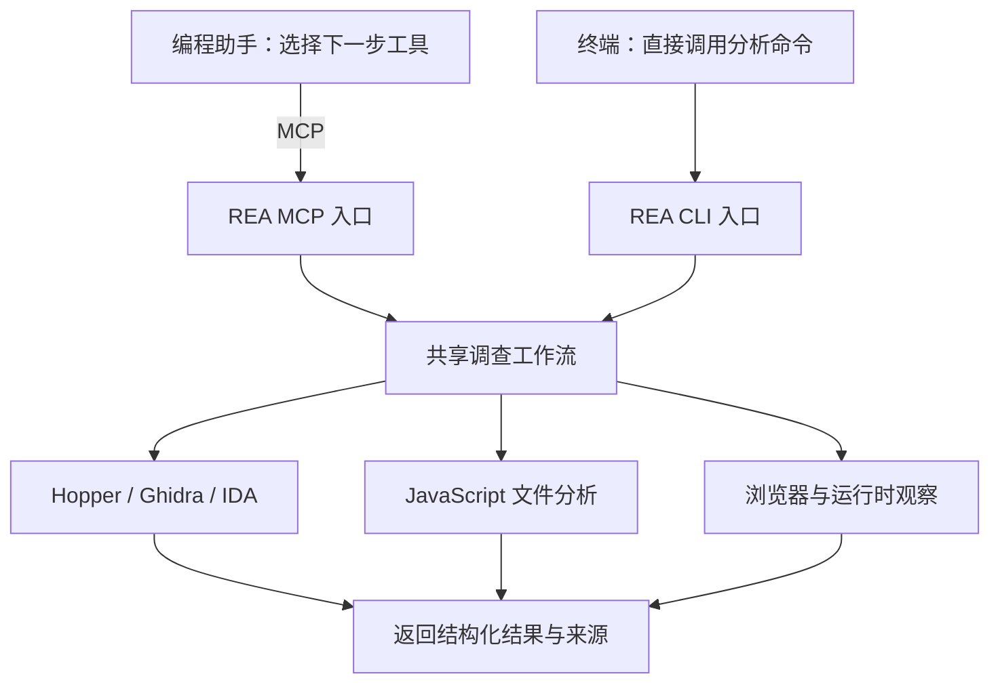
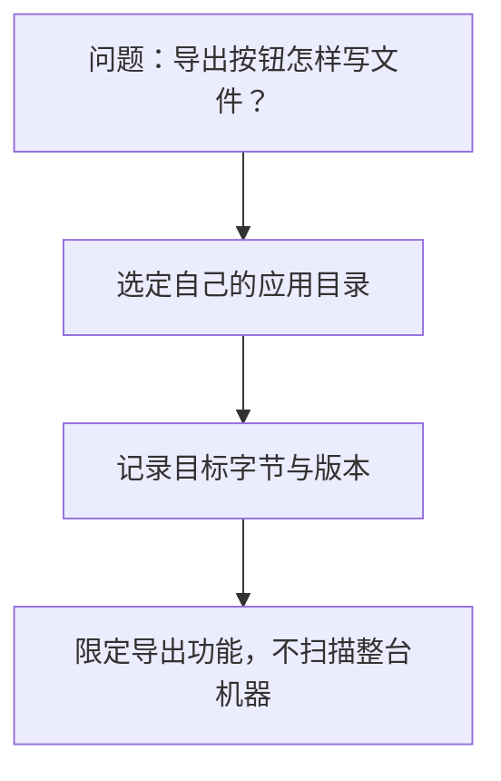
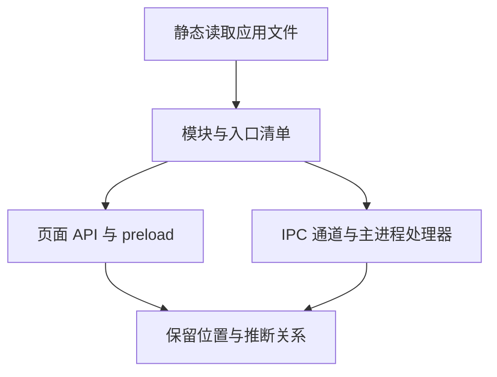
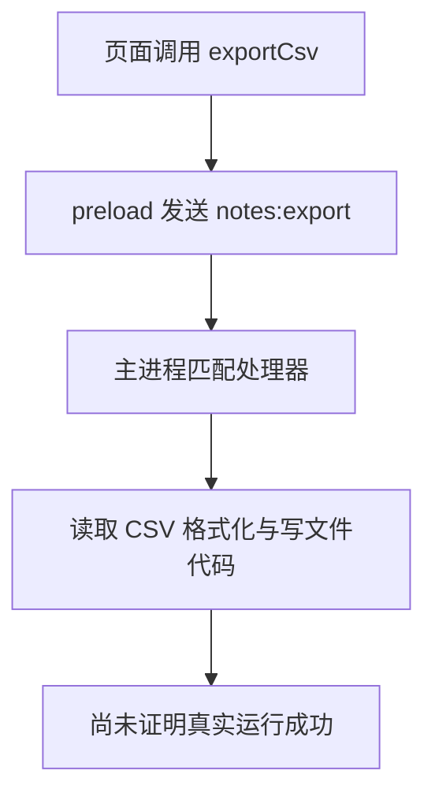
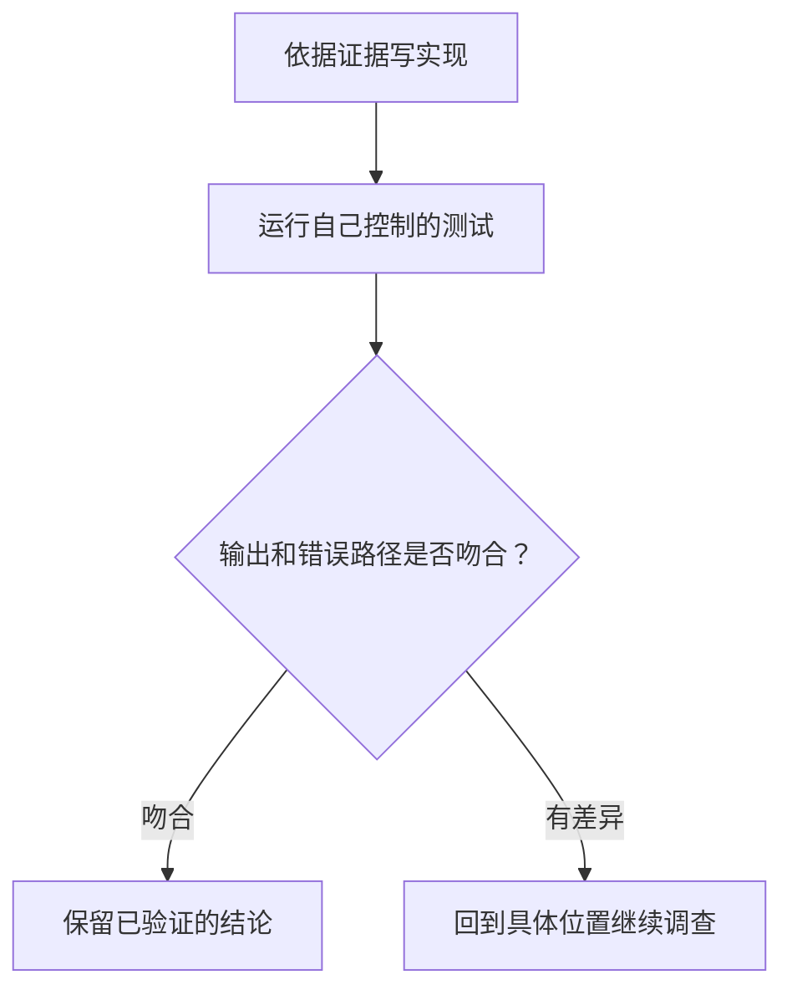
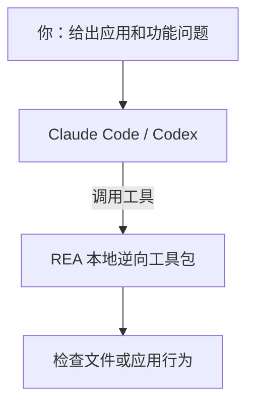

# REA research ledger

## Scope and evidence standard

- Requested outcome: a Chinese distilled article explaining REA mechanisms, useful applications, evidence quality and operational limits.
- Owner: `src/content/posts/zh/2026-10-11-rea-agent-reverse-engineering.mdx`, `src/assets/rea/`, and this ledger. No shared component, configuration, dependency or public contract changes.
- Checked on 2026-10-13. Source checkout pinned to released tag `rea-agents-6.4.0`, commit `a56f7bb668ab23fec8d33f7af353ac7ed2fe1895`; release dated 2026-10-11.
- Public documentation and source inspection establish implementation intent, not successful execution on every host. Website examples are author-reported unless separately exercised below.
- No account setup, native engine installation, third-party binary execution, commit or publication.

## Source inventory and coverage

The pinned README contains 12 topic units: Quick start; How REA works; What you can analyze; Showcases; FAQ; Documentation; Star history; Disclaimer; Contributing; License, plus the introductory product explanation and community block. All 12 were read. Nine inform the article; Star history, community promotion and contributor onboarding are deliberately excluded. This inventory groups sections by reader-visible topic rather than Markdown heading depth.

Three worked guides were read in full. Each contains five instructional sections, for 15 read and 15 used: native example/question/results/reconstruction/custom target; Electron example/question/code trace/example execution/writer follow-up; browser example/browser setup/agent prompt/CLI capture/request and script interpretation. They support different authority levels, not one generic cloning claim.

Selected technical documents, read in full: architecture map; tool design; MCP runtime contracts; CLI and Evidence; JavaScript Application Graph; reconstruction readiness; native investigation; Security Policy; DX-Ball evidence; guide-example evidence. Installation is a routed reference: start/release boundary/skill-only, setup transaction/readiness/Hopper, and Ghidra sections were read; unrelated client-specific installation details are outside this article's scope.

Broader README targets are covered in the capability table, with narrow prerequisites preserved. Further format-specific guides are linked by the README; this research does not establish real-engine support beyond the checks described below.

## Source ledger

All sources are primary. Twenty-two are project material; three protocol/engine references are primary external context. Exact article titles and URLs follow.

1. REA · README at 6.4.0 — https://github.com/morluto/rea/blob/rea-agents-6.4.0/README.md
2. REA · 6.4.0 release — https://github.com/morluto/rea/releases/tag/rea-agents-6.4.0
3. REA · Architecture map — https://github.com/morluto/rea/blob/rea-agents-6.4.0/docs/architecture.mermaid
4. REA · MCP runtime contracts — https://github.com/morluto/rea/blob/rea-agents-6.4.0/docs/mcp-contracts.md
5. REA · CLI and Evidence — https://github.com/morluto/rea/blob/rea-agents-6.4.0/docs/cli.md
6. REA · JavaScript Application Graph — https://github.com/morluto/rea/blob/rea-agents-6.4.0/docs/javascript-application-graph.md
7. REA · Installation and setup — https://github.com/morluto/rea/blob/rea-agents-6.4.0/docs/installation.md
8. REA · Native UI and dispatch investigation — https://github.com/morluto/rea/blob/rea-agents-6.4.0/docs/native-investigation.md
9. REA · Reconstruction readiness conformance — https://github.com/morluto/rea/blob/rea-agents-6.4.0/docs/reconstruction-readiness.md
10. REA · Security Policy — https://github.com/morluto/rea/blob/rea-agents-6.4.0/SECURITY.md
11. REA · Native Binary Analysis guide — https://rea.tools/guides/native/
12. REA · JavaScript and Electron Analysis guide — https://rea.tools/guides/javascript/
13. REA · Browser and Network Analysis guide — https://rea.tools/guides/browser/
14. REA · DX-Ball sound-pan evidence — https://github.com/morluto/rea/blob/rea-agents-6.4.0/website/evidence/dx-ball-sound-pan.md
15. REA · Guide example evidence — https://github.com/morluto/rea/blob/rea-agents-6.4.0/website/evidence/guide-examples.md
16. REA · Notes Electron example — https://github.com/morluto/rea/tree/rea-agents-6.4.0/website/public/examples/notes-electron
17. REA · EvidenceLedger implementation — https://github.com/morluto/rea/blob/rea-agents-6.4.0/src/application/investigation/EvidenceLedger.ts
18. REA · MIT License — https://github.com/morluto/rea/blob/rea-agents-6.4.0/LICENSE
19. Model Context Protocol · Architecture overview — https://modelcontextprotocol.io/docs/2026-07-28/learn/architecture
20. Ghidra · Software reverse engineering framework — https://github.com/NationalSecurityAgency/ghidra
21. Model Context Protocol · Security Best Practices — https://modelcontextprotocol.io/docs/2026-07-28/tutorials/security/security_best_practices
22. REA · MCP process entrypoint — https://github.com/morluto/rea/blob/rea-agents-6.4.0/src/main.ts
23. REA · JavaScript application service — https://github.com/morluto/rea/blob/rea-agents-6.4.0/src/application/javascript/JavaScriptApplicationService.ts
24. REA · JavaScript artifact reconstruction — https://github.com/morluto/rea/blob/rea-agents-6.4.0/docs/javascript-artifact-reconstruction.md
25. REA · Downloadable Notes example — https://rea.tools/examples/notes-example.zip

## Presentation plan

- Backdrop: reverse engineering already has mature disassemblers/decompilers; agent/tool integration lowers manual navigation effort. Do not attribute popularity to unverified star growth.
- Mechanisms: host versus MCP server versus analysis engines; question-driven narrowing; native assembly/caller/constants; Electron static IPC versus runtime observations; canonical Evidence and unknowns; retained records, snapshots and response views.
- Aftermath: published 6.4.0 expands Android and large-analysis workflows; meaningful progress is more inspectable investigation, not guaranteed app duplication.
- Revised outline: twelve numbered canvas sections: product definition, problem, system design, implementation, user workflow, four-step investigation, native case, Electron/browser, Evidence/session, capability range, security, decision. The first five directly answer the user's foundational questions.
- ScrollStory: four Mermaid-authored, static SVG stages describing a feature investigation. Cover is a separate simple product-use diagram; architecture shows both CLI and MCP entry points. No Mermaid runtime or new site JavaScript.
- Number ledger: release 6.4.0/2026-10-11; native example REA 4.1.0/Ghidra 12.1.4/Linux x64/2026-10-07; 3,205 = 641 positions (0–640) × five scales (0, 0.5, 1, 20, −1); 63 compiled bytes for one function; MCP pinned-client budget 10 MiB; Node requirements as installation docs. No general success rate or speedup.

## Local empirical check

On 2026-10-13, macOS arm64, Node.js 22.23.2, downloaded the released `rea-agents@6.4.0` package into a temporary npm cache and ran its public CLI on the six-file, project-owned Notes Electron fixture from the pinned tag:

```sh
npx -y rea-agents@6.4.0 analyze-javascript-application /absolute/path/to/notes-electron --json
```

- Exit 0; stdout is a complete Evidence record, 393,026 bytes in the captured run.
- Root artifact SHA-256: `0ee325d4eaf7f94b62b2962044995fe1efe9f1d31411eb035118b19b1f56f7bb`.
- Evidence ID: `ev_f9e84d1f7fbc9c0ae782988290b40f9ccb48773bea3cc64d5b6a2aac8d8e2372`.
- One BrowserWindow, one preload entrypoint, one exposed API member.
- IPC: one literal channel, one renderer transmission, one main handler, one paired transmission, zero ambiguous transmissions.
- Explicit limits: inert parsing; static relationships do not establish execution; dynamic/obfuscated paths can remain unresolved.
- No Electron process launched; no model, native engine, provider setup or personal agent configuration changed. Raw temporary output is not a public repository asset.
- Not verified: binary/DX-Ball execution, compiler-byte replay, real commercial application reconstruction, browser runtime capture, Android/JEB/firmware workflows or hosted-model behavior.

## Mermaid source

Rendered during authoring into token-colored SVG. The site receives static SVG components only.

### Architecture / cover



### Step 1 / scope



### Step 2 / inspect



### Step 3 / trace



### Step 4 / verify



### Product definition / cover



## Humanize and verification gates

Meaning lock: source list, dates, version names, API names, recorded numbers, evidence calibers, structured tables and diagram labels remain unchanged during prose polish. Apply the repository humanize-text skill before check/build. Final verification must include native site check/build, four-width screenshots, ScrollStory steps 2/3, reduced motion, TOC clearance, locales/list links and script regression. No claim that editorial preview checks establish REA's untested engine workflows.

## Product-first revision

The user found the initial account insufficient to explain the product. The first version foregrounded evidentiary constraints and had no standalone product definition or concrete request-to-code implementation walkthrough. This revision changes the article's teaching sequence, not the provider capability claims.

- Success criteria: a new reader can state what to install, who supplies the model, what REA executes, what it returns, why it is useful, and how to complete a first analysis.
- Scope: article and research ledger; regenerate only architecture/cover SVGs. Preserve four existing story diagrams, native metrics, empirical scope and public route. No shared changes.
- Added primary material: complete `src/main.ts` and `JavaScriptApplicationService.ts`; all eight sections of `javascript-artifact-reconstruction.md` were read (public workflow, integrity, large results, recovered structures, authority, safety, bounds, verification). Six support the explanation; detailed ASAR integrity and numeric internal bounds are not foregrounded.
- Definition: npm package, CLI, MCP process, bundled Skill and separately supplied analysis engines.
- Design: model/host decisions, two entry points with shared application workflows, provider adapters and reusable records.
- Implementation: actual TypeScript/Node stdio entry, validated application service, artifact inventory, inert AST analysis, conservative IPC pairing, native bridge and browser CDP paths.
- User workflow: scoped setup preview and apply commands, restart/reconnect, target path plus natural-language task, direct CLI alternative, real IPC result excerpt and an explanation of each field.
- Humanize pass: split dense explanations and replaced generic framing; kept the new draft's source list, numbers, quotations, technical tokens, code and tables unchanged. Previous metrics and unverified engine boundaries retained. No new end-to-end setup claim.

### Revision verification

- Repeated the novice workflow using the official downloadable ZIP, not only a source-checkout folder. The archive contains six files under `notes-example/`; the public `rea-agents@6.4.0` CLI exited 0 after parsing four JavaScript files with zero parse failures. Its IPC fields match the five-field excerpt in the article exactly. The example remains static; no Electron or personal-agent setup was run.
- `npm run check`: 75 files, zero errors/warnings/hints in diagnostics. `npm run build`: exit 0, 210 pages, Pagefind completed. Existing site notices remain.
- All 25 primary-source links return HTTP 200; source inventory is retained above. The added implementation document has eight sections read and six used, with detailed integrity and numerical parser-budget sections intentionally not foregrounded.
- Inspected updated definition, architecture, implementation and user instructions at 1280/1680/768/390 pixels. No page overflow, browser errors, duplicate IDs or broken Markdown. Twelve chapter indices are sequential; 25 sources render.
- Existing story steps 2/3 still switch on desktop and interleave all four diagrams on narrow screens. Reduced-motion has zero-second frame transitions, visible prose and final statistics. Without JavaScript, all four diagrams and final values remain visible.
- Wide TOC follows the chapter, clears content by 18px and includes the two user-workflow subsections. Counters settle on 3,205/63. Article script is unchanged at 2,492 bytes gzip; checked framework routes remain script-free.
- Review scope relative to the prior delivery: article, ledger and two diagram assets only. Four original story SVGs, shared UI, site configuration and existing Aster work are untouched. No commit or push.

## Completed editorial verification

The following records describe the initial version. The product-first revision is audited separately below.

- Applied humanize-text: reviewed every prose block in one restrained technical voice; removed redundant framing and split dense sentences. Automated draft comparison preserved front matter, source URLs, all numeric tokens, inline technical tokens, quotations, tables and stats. The separate cover SVG import fixes per-page ID identity, not prose meaning.
- `npm run check`: 75 files, zero errors, warnings or hints in diagnostics. Existing empty-collection and Markdown API notices remain.
- `npm run build`: exit 0, 210 pages; Pagefind completed. Existing empty-collection, Markdown deprecation and Vite head-injection notices remain; no shared fixes included.
- All 21 source URLs returned HTTP 200.
- Existing `npm run preview` process serves the built output. Screenshots at 1280/1680/768/390 pixels inspected, including architecture, steps 2/3, tables, stats and prose. No page overflow, browser errors, duplicate IDs, broken emphasis or SVG foreignObject elements.
- Desktop frames switch to steps 2/3; narrow screens relocate all four diagrams into their panels. Wide TOC has an 18px clearance and follows the selected chapter.
- Count-up sample progressed through 926/18 and settled at exactly 3,205/63. These intermediate UI values are animation checks, not research metrics.
- Reduced-motion has no hero/reveal animation and zero-second story transitions, final stats and usable state selection; existing inactive-panel emphasis remains. With JavaScript disabled, all four frames are visible, final stats render, and the mobile page has no overflow.
- Chinese home and post list link the new article; English post list excludes it, and article language toggles are disabled as intended for this single-language run.
- Article enhancement script remains the existing single module, gzip 2,492 bytes. Home, post lists, CV and 404 have zero scripts. Existing Aster article still renders with one script and no overflow.
- Scope audit: eight new files (article, ledger, six generated static SVGs). No shared modules, dependencies, established contracts, commits or publication. Existing Aster work preserved.
- Screenshots and machine-readable preview reports are temporary authoring evidence, not site test infrastructure or public assets. Real REA validation remains limited to the public CLI fixture run above.
