# Scion research ledger

## Scope and plan

- Outcome: a Chinese product-first explanation of Anthropic's internal Scion source-control system, not a migration of this website.
- Owner: `src/content/posts/zh/2026-10-13-scion-source-control.mdx`, `src/assets/scion/`, and this ledger only.
- Stages: verify the announcement and surrounding primary sources; explain the product and user workflow; map the write/query/checkout paths; draft; apply the humanize meaning lock; run native check/build and preview QA.
- Non-goals: public Scion installation, reverse engineering unavailable binaries, Git migration, new components, dependency changes, English translation, commit, or publication.
- Verification: native `npm run check` and `npm run build`; preview at 1280/1680/768/390; intermediate story states, counters, reduced motion, no-JS fallback, TOC clearance, locale behavior, framework script regression, source URL checks.

## Source register (fetched 2026-10-15)

All ten sources are primary. The GitLab article is a vendor's response, not independent replication of Anthropic's benchmarks.

1. **Redesigning source control at Anthropic**, published 2026-10-13. https://www.anthropic.com/engineering/redesigning-source-control
2. **Scaling Git for the agentic software factory**, published 2026-10-13. https://about.gitlab.com/blog/scaling-git-for-the-agentic-software-factory/
3. **Why Google Stores Billions of Lines of Code in a Single Repository**, Google Research, 2016; abstract used, not the full paper. https://research.google/pubs/why-google-stores-billions-of-lines-of-code-in-a-single-repository/
4. **Overview**, Sapling scaling documentation; full three-section body read. https://sapling-scm.com/docs/scale/overview/
5. **Git Internals - Git Objects**, Pro Git; object/tree/commit sections read for snapshot and content-addressing context. https://git-scm.com/book/en/v2/Git-Internals-Git-Objects
6. **partial-clone Documentation**, Git; design, missing objects, fetching, and limitations read. https://git-scm.com/docs/partial-clone
7. **git-sparse-checkout Documentation**, Git; description and commands read. https://git-scm.com/docs/git-sparse-checkout
8. **Git Branching - Basic Branching and Merging**, Pro Git; branching, fast-forward, three-way merge and conflict sections read. https://git-scm.com/book/en/v2/Git-Branching-Basic-Branching-and-Merging
9. **Git - diff-format Documentation**, Git; the generating-patch-text section is used; raw and combined merge formats are not the subject of this article. https://git-scm.com/docs/diff-format
10. **Git - About Version Control**, Pro Git; local, centralized and distributed version-control sections read to ground the full-clone/offline comparison. https://git-scm.com/book/en/v2/Getting-Started-About-Version-Control

## Core-difference revision

- Reader request: explain the fundamental Git/Scion distinction prominently, rather than leaving it scattered across implementation chapters.
- Owner and scope: this article and ledger only; existing graph assets and shared components remain unchanged.
- Plan: recheck the published client/server and data-model descriptions; rewrite the opening around local autonomy versus an online service; compare the same homepage edit under a network interruption; distinguish a change record from a snapshot; correct the interpretation of the main-pointer diagram; humanize and run native/preview regression checks.
- Evidence: Anthropic's principles and data-structure sections, Pro Git's distributed-VCS section, and its object/tree/commit explanation. Scion remains vendor-documented, not independently executed.
- Guardrails: full Git clones can operate offline, but partial clones may need missing objects; Git can reuse unchanged objects and use hosted APIs; a saved commit not moving main is not Scion-specific; logical service authority does not imply a single physical server.
- Presentation: the first chapter and cover state the distinction directly. A concrete offline example explains the consequence; chapters 5/6 retain the detailed data model. The conclusion reinforces the tradeoff. No additional table or diagram is necessary for this prose correction; existing merge/diff/history/cache graphics remain.
- Humanize gate: applied to the new Chinese explanatory prose. The meaning-lock comparison preserved front matter, all numerical tokens, URLs, inline code, named terms and complete structured blocks; the read-through removed an awkward tradeoff phrase and a redundant transition without changing claims.
- Final native checks: `npm run check` passed for 75 files with zero errors/warnings/hints; `npm run build` passed with 215 pages and Pagefind. Existing empty-collection and MDX/toolchain notices remain.
- Fresh preview review: passed at 1280/1680/768/390, including the opening and offline example. Desktop/mobile screenshots were inspected and shown in the task conversation. Existing graph assertions, all five story frames, reduced motion, no-JS readability, counters, TOC tracking/18px clearance and locale behavior passed. The article retains one table, ten chapters and one existing 2,492-byte gzip module; the source list now has ten entries. Framework pages remain script-free and the prior REA article remains overflow-free.
- Evidence: `/tmp/scion-core.qRexWJ/` contains the prose snapshot/meaning-lock result, check/build logs, and `screenshots/report.json`, `screenshots/details.json` and viewport captures. These are temporary diagnostics, not project verification infrastructure or committed assets.
- Scope audit: this revision changes only the MDX article and this ledger; existing SVG assets, shared modules and established public contracts are unchanged. The eight-unit source inventory remains covered; Scion behavior and performance are still vendor-reported, not independently reproduced.
- Commit gate: on 2026-10-15, after the latest desktop/mobile preview, the user accepted the revision and requested a local commit of the article, its eleven SVG assets and this ledger. This supersedes the pending-approval status of earlier revisions below. Push/publication is not authorized.

The nonexistent Sapling introduction/architecture URL was discarded and replaced with source 4. Search results about GoogleCloudPlatform/scion are a different product and are excluded.

## Announcement inventory and coverage

The complete announcement body was read, including its footnote. Eight editorial units were inventoried before outlining; all eight are accounted for:

| Unit | Topic | Article coverage |
| --- | --- | --- |
| 1 | Introduction: shipped Scion, Antique, migration | Definition and migration |
| 2 | Growing monorepo: workloads and exhausted Git optimizations | Problem |
| 3 | Agent-scale principles: online clients, asymmetry, API, scale, cheap commits, optional working copy | Design, usage, checkout |
| 4 | How Scion works: changesets, derived data, servers and cache tiers | Data model, query, checkout |
| 5 | Lessons: AI assistance, engineer judgment, testing, security, operations and merge policy | Migration and tradeoffs |
| 6 | Wider ecosystem: unsuitability for general use, bespoke lifecycle, potential Git improvements | Definition and closing |
| 7 | Acknowledgements | Authorship retained in primary source; no reproduction of the name list |
| 8 | First-parent footnote | Data model explanation |

No figure-only numerical values are transcribed. The six source illustrations' text captions were inventoried; diagrams here are original explanatory redraws from the textual architecture, not copies or screenshots.

## Evidence boundaries

- Scion is an internal, already deployed version-control system. The announcement does not provide public source, a downloadable client, a supported external service, installation commands, language/runtime details, a protocol schema, or a complete security model.
- `scn`, `scion-daemon`, `scion-cache`, `scion-server`, Spanner, and blob/cloud storage are publicly named. Do not invent their endpoint names or CLI flags.
- Changesets are first-parent-relative changed-file lists, not necessarily textual patches. File contents are compressed content-addressed blobs. Trees still exist in the checkout protocol.
- Commit creation is separate from ref movement and reviewed landing. Main/release refs still exist; ref updates use compare-and-swap on a Spanner row. Do not claim no coordination anywhere or no merge conflicts.
- The daemon/cache/server topology is the read/checkout path; server-side writes and metadata APIs must not be depicted as automatically passing through the object caches.
- No fully materialized repository exists at any tier according to the vendor. Logical authority is not a single physical full-repository machine.
- Central availability, cache authorization, disaster recovery, garbage collection of orphaned objects, exact consistency timing, latency distributions, and benchmarks are not independently verified.
- The homepage example is explicitly hypothetical, not a measured Anthropic workflow or command transcript. Versions A/B/C must be distinguished from file content identifiers X/Y and from tasks named 甲/乙.

## Backdrop, mechanisms, and aftermath

Backdrop: a large monorepo plus extremely frequent ephemeral jobs multiplies checkout overhead; Git has shallow/partial/sparse facilities, and Anthropic says it already used them. Google and Meta supply prior art, so centralized code services and virtual working copies are not new inventions.

Mechanisms: bounded thin client; changeset append and first-parent file deltas; derived indexes for history/blame/graph; server-side source-control RPCs; immutable object requests; sparse/virtualized materialization; node/region/authority cache tiers; strict tiering for failure isolation; main ref CAS separate from commit creation.

Aftermath: migration of the monorepo and companion review/search/CI ecosystem; internal measured resource savings, not general Git benchmark claims; online and ecosystem tradeoffs; ordinary teams can borrow selective checkout and server-side querying without rebuilding VCS.

## Number ledger

All Scion measurements below are Anthropic's 2026-10-13 self-report about its internal workload. Sample counts, percentile timings, machine configurations, and independent replication are not supplied.

| Figure | Caliber | Point |
| --- | --- | --- |
| about 2,500/day in May 2026; over 30,000/day by September | Merged changes to Anthropic's monorepo, not all commits or lines of code | Write workload growth |
| almost 100 GB; over 25 GB | Main history; compressed working copy respectively | Repository size |
| about 25 million/day | CI checkouts; excludes developers, agents and research | Read amplification |
| over 600 PB/day | Counterfactual naive fetching, not actual observed traffic | Why full repeated transfer is infeasible |
| several hundred | Peak internal Git mirrors | Existing mitigation burden |
| over 99% per tier | Vendor-reported cache hit rate; object/request/byte denominator unspecified | Read reuse; do not multiply as measured origin traffic |
| 200x smaller | Scion infrastructure CPU/memory footprint vs earlier Git mirrors | Infrastructure comparison, not speed or total company cost |
| two orders of magnitude faster | CI/research checkouts, seconds rather than minutes | Checkout only, not all operations |
| 25% | CI CPU capacity win | Fleet benefit, not universal per-job reduction |
| seven people, five months | Scion, Antique and related systems plus migration | Team scope, not Scion alone |
| 20x less memory; 4x faster | Model-assisted rewrite of ingestion prototype | One implementation example, not general developer productivity |

## Revision plan: novice teaching and visual redesign

### Follow-up: real history and diff diagrams

The user rejected the record/card-heavy revision as still looking like tables. The current scope is to replace pictorial records where a relationship diagram would teach more, not to remove all structured data indiscriminately.

- Outcome: readers can trace a genuine Git branch and two-parent merge, read a real one-line unified diff, distinguish a changeset's existence from main's position, and see file history/cache relationships graphically.
- Owner and scope: this MDX article, its SVG assets and this ledger. Shared components, global tokens, dependencies and repository branches/commits remain untouched.
- Visual changes: a Git commit DAG (A/C on main, B on a copy branch, merge M); an actual diff hunk; before/after main reference diagrams; file-lineage graph replacing the history-question table; cache-to-private-file relationship drawing replacing the boxed comparison.
- Evidence: official Git references plus an isolated temporary Git fixture for A/B/C/M, merge parents and the exact diff hunk. The Scion reference diagrams remain conceptual, not execution evidence.
- Verification: validate Mermaid models; humanize only the explanatory prose with locked facts; native check/build; four-width screenshots of each new graphic, all story states, no-JS/reduced-motion, text bounds and minimum phone label sizes.
- Publication: no commit or push; previous screenshots were not user approval.

User feedback: the first draft depended on arrow diagrams and assumed prior technical knowledge. Passing build/layout checks did not establish teaching or design quality. Approval was not granted.

- Outcome: a reader without Git knowledge can explain what Scion does, follow one edit through saving and landing, and identify what is shared vs private.
- Scope: the same article, its nine static SVG assets, and this ledger. No shared component, design token, configuration or public contract changes.
- Teaching fixture: an explicitly hypothetical website; `site/home.md` changes from `欢迎` to `你好`; `site/styles.css` is needed, `docs/` and `assets/` are not needed in the illustrated task. Real tasks can require configuration and other dependencies.
- Version labels A/B/C and content labels X/Y are teaching labels, not real Scion IDs. Task names 甲/乙 avoid overloading the version letters. No simulated CLI commands or purported product screenshots.
- Main lifecycle: select task scope; reuse/read immutable objects; edit private working copy; server creates changeset; review and land separately; production deployment is a later step.
- Second example: two tasks start from version A. Task 甲 edits its own working copy, while task 乙 still uses A. Shared immutable storage is not a shared writable workspace.
- Third example: B edits homepage copy and C later edits styles; history/blame queries find the relevant change, not just the newest change.

## Revised outline and visual map

1. Define version control with the homepage example, then define Scion and availability.
2. Explain temporary jobs and repository preparation; a proportional zero-baseline bar chart for the two official daily-merge observations.
3. Five illustrated lifecycle steps with visible files, changed text, a receipt and mainline adoption state.
4. Responsibility panels: local files vs shared version service; role cards name the actual components.
5. Changeset receipt, immutable content, first-parent basis and separate CAS of main.
6. Worked history/blame questions and derived indexes.
7. Two-agent working-copy illustration; sparse vs virtual preparation cards and cache protocol explanation.
8. Qualified resource/checkout results and count-up statistics.
9. Migration, engineering judgment, testing, security and release tradeoffs.
10. Adoption decision and Git-compatible alternatives.

## Mermaid specifications

Valid Mermaid specifies the relationships, state sequence and chart data. The reader-facing SVGs use authored, token-only layouts with annotated file/record panels rather than Mermaid's default arrow-box layout. These are explanatory illustrations, not actual Scion UI. No runtime Mermaid is shipped.

### Cover: immutable version relation versus mutable main reference

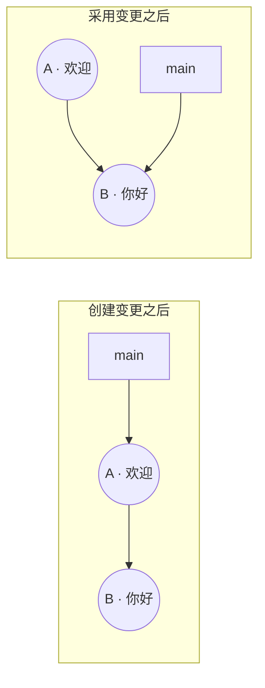

### Responsibilities

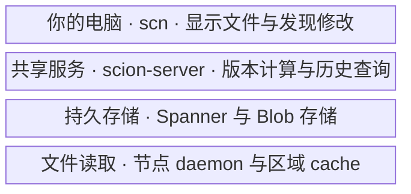

### Changeset receipt

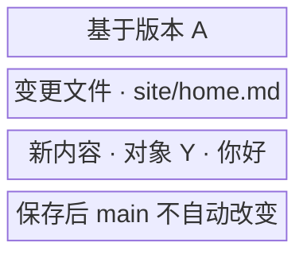

### Selected files

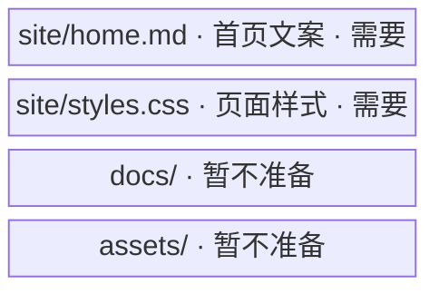

### Read reuse

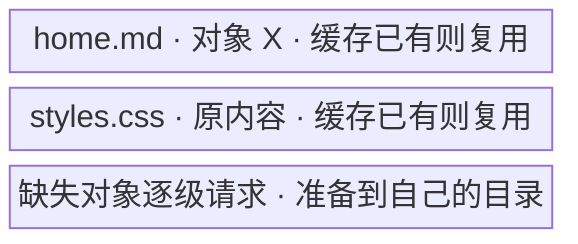

### Edit: verified unified diff

The reader-facing pane is a re-layout of this actual hunk from the isolated Git fixture, with explanatory line numbers and deletion/addition labels. It is not a table, a purported Scion screenshot, or a claim about Scion's stored representation.

```diff
@@ -1,3 +1,3 @@
 # Home
-欢迎
+你好
 链接：/help
```

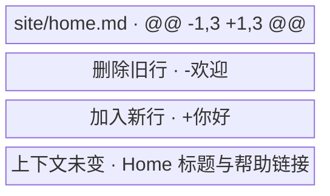

### Saved versus landed

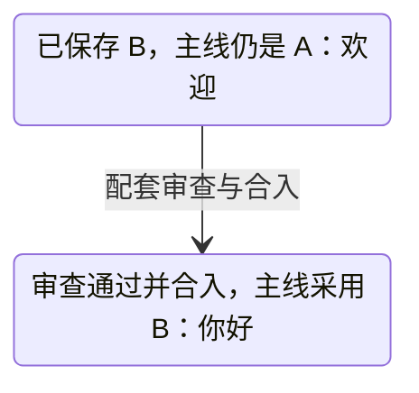

### Private working copies

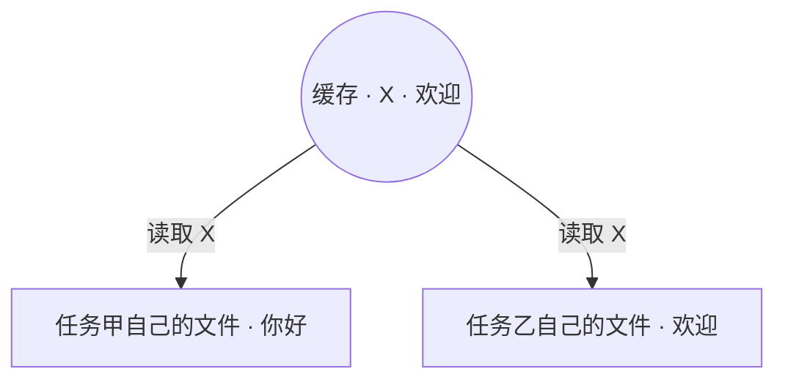

### Official workload

September is over 30,000. The plot uses 30,000 as the lower bound, never a fabricated exact value. Both bars share a zero baseline and scale; only two observations are plotted.

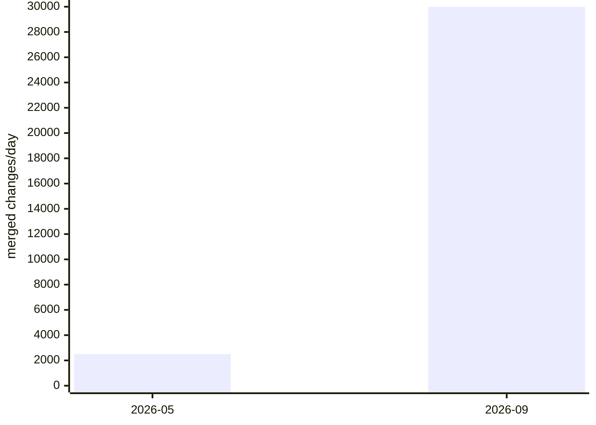

### Git branch and merge

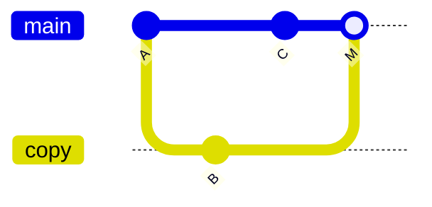

This is a diverged history with a real merge commit. M has parents C and B; the common ancestor is A. It does not imply every Git merge creates a merge commit. The illustration's curves show parent/child relationships; they are not network arrows or a literal clock axis.

### File lineage in a separate linear history

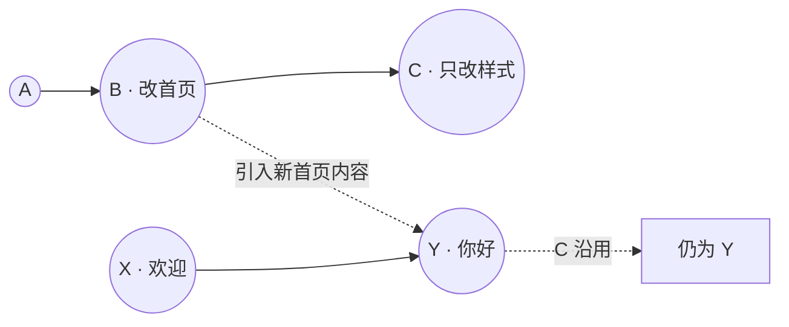

This independent teaching scenario has C directly based on B, unlike the diverged Git example above. The isolated fixture verifies that C modifies only `site/styles.css` while `git blame` attributes homepage line 2 to B. It does not demonstrate Scion's internal blame implementation.

### Git fixture evidence

The fixture lives only at `/tmp/scion-graphs.nwA16h/fixture`, with no remotes. Repository-local identity uses the reserved invalid address `fixture@example.invalid`; hooks and signing are disabled for fixture commands only. No website branch or commit is changed.

- `git-fixture.json`: verifies M has exactly the two expected parents and preserves both edited files.
- `homepage.diff`: exact `git diff` output verifies one removed and one added line with unchanged context.
- `lineage.json`: verifies the independent linear C has parent B, changes only the style file, and keeps B as the provenance of the homepage copy line.
- New source references are Git's own branching/merging chapter and diff-format documentation; Scion remains documented through its original vendor source.

### Graph revision status

The graph revision passed the humanize meaning lock for front matter, numeric tokens, URLs, inline code, named terms and complete structured blocks. A subsequent teaching clarification explains the diff hunk range and old/new line numbers without changing vendor facts. All eleven Mermaid specifications compiled successfully; the eleven site assets are token-only static SVGs, with no raster diagrams, foreignObject nodes, hard-coded colors, new dependencies or runtime scripts.

Final native verification, rerun after the diff clarification, passed: `npm run check` reports 75 files with zero errors/warnings/hints; `npm run build` generates 215 static pages and completes Pagefind. Existing toolchain notices remain unchanged in kind.

Fresh browser verification at 1280/1680/768/390 passed. Git's four parent edges match the isolated fixture; the diff contains the expected removed and added lines; the Scion teaching graph selects A before landing and B afterward. All new graphic labels fit their SVG viewports and remain at least 12 CSS pixels on the phone. The article now contains one HTML table, reserved for reported performance and measurement qualifications, alongside ten chapters and nine primary-source links.

Story frames, TOC clearance/tracking, count-up, reduced motion, no-JS readability, locale inclusion and existing framework-page behavior passed regression checks. There was no page overflow, script exception, duplicate ID or additional article script; the existing article module remains 2,492 bytes gzip. Desktop/mobile screenshots of the merge graph, diff, main-pointer movement and file-history graph were visually reviewed and shown in the task conversation. Reader approval remains pending; technical verification does not establish visual acceptance.

Evidence is under `/tmp/scion-graphs.nwA16h/`: the isolated Git fixture, `homepage.diff`, `git-fixture.json`, `lineage.json`, Mermaid diagnostics, native check/build logs, and `screenshots/report.json` / `screenshots/details.json`. Temporary evidence and build output are not site assets. The earlier card-oriented verification below is historical and is not evidence of acceptance of this graph revision.

Changes remain confined to the article, its local SVG assets and this research ledger. No shared module or established public contract changed. No website commit or push was made. Scion diagrams remain explicitly labeled explanations of its published design, not screenshots or evidence from an executed Scion runtime.

## Card-oriented revision verification (superseded)

The revised draft passed the humanize meaning lock: front matter, numeric tokens, URLs, inline code, named terms and complete structured blocks stayed unchanged during the prose pass. The read-aloud check simplified paragraph rhythm and removed abstract introductory scaffolding. Later authoring corrections distinguished task names 甲/乙, version labels A/B/C and content labels X/Y, shortened the headline to avoid splitting a phrase, and explicitly defined push before its use. These were reviewed fixture/presentation corrections, not changes to vendor facts.

All nine Mermaid specifications rendered successfully in authoring-time diagnostics. The article uses nine token-only static SVG illustrations: before/after, responsibilities, selected files, cache reuse, edit, changeset receipt, saved/landed state, private working copies and the official workload chart. There are no arrow markers, raster images, foreignObject nodes, gradients or new runtime scripts. White fills resolve to the existing Tailwind white token.

Final native verification passed: `npm run check` reports 75 files with zero errors/warnings/hints; `npm run build` generates 215 static pages and completes Pagefind. Existing Markdown configuration, empty collection and MDX toolchain notices remain unchanged in kind.

Fresh preview QA at 1280/1680/768/390 passed without page overflow, script exceptions, duplicate IDs or malformed Markdown. Story steps 2/3/4/5 each select the corresponding frame; narrow layouts interleave all five frames with the text. The 1680 TOC clears the article by 18px and tracks chapters. The count-up progresses and settles at `200 倍`; reduced-motion and no-JS both preserve that final value. No-JS exposes all five frames and reduced-motion has zero frame transition duration and no hidden prose.

Visual review covered desktop/mobile hero, the daily-merges chart, changeset receipt, before/after editing, saved versus landed, working-copy isolation and reduced motion. A final chart refinement reduced the coordinate canvas and increased label sizes, added an explicit zero label, and retained the same 12:1 lower-bound bar-height ratio. Final four-width browser assertions confirmed every chart label is at least 12 CSS pixels on the phone and lies inside its SVG viewport. Representative screenshots were shown in the task conversation. User approval of the revised design is still pending; technical checks do not establish that the reader finds it clear or visually appropriate.

Regression checks confirm one 2,492-byte gzip article module; framework home/list/CV/404 pages remain script-free. Chinese home/list link to the article, English home/list do not, and the article's English toggle is disabled. The prior REA page remains overflow-free with its existing single module.

Evidence is under `/tmp/scion-redesign.Y2Tboj/`: `screenshots/report.json`, `screenshots/details.json`, four-width and intermediate-state screenshots, check/build logs and Mermaid validation logs. No temporary evidence or build output is added to Git. Changes remain confined to the article, `src/assets/scion/` and this ledger; no shared module or established contract changed. No commit or push was made.

The eight-unit announcement inventory and seven primary references remain covered. Scion's internals and benchmarks remain vendor reports, not a public runtime test. The first draft's verification below is historical evidence, not approval of either visual design.

## First-draft verification (superseded)

The Chinese technical prose received the required humanize pass. The pre/post comparison passed for front matter, numerical tokens, source URLs, inline code, named terms and complete table/story/stat/summary blocks. Read-aloud review removed ceremony and repetitive contrast scaffolding without changing evidence claims.

Subsequent QA corrections were explicitly outside that prose-only pass: remove a duplicated count suffix in the article's Stat props, shorten architecture labels for phone readability, and clarify that origin traffic estimation concerns miss rates and matched request/byte denominators. No shared component was changed.

Native check passed (75 files, zero diagnostics); build passed (215 static pages and Pagefind). Existing toolchain notices remain: deprecated Markdown plugin configuration, empty academic collections, and MDX head-inject directives. No new runtime code or dependencies were added.

Preview QA at 1280/1680/768/390 found no page overflow, JavaScript errors, duplicate IDs, foreignObject nodes or malformed Markdown. Ten chapters and seven source links render. Story steps 2 and 3 select the matching frames; below 900px all frames move into their respective panels. The 1680 TOC has 18px clearance and tracks the section; the counter reaches its final value. Reduced motion removes transitions and hides no prose; no-JS retains all four story frames. Final rechecks confirmed `30,000+` in animated, reduced-motion and no-JS modes. Desktop/mobile hero, the corrected mobile architecture, story steps 2/3 and reduced-motion screenshots were visually inspected and shown in the task conversation. User visual approval is still required before any later commit or publication.

Home and Chinese posts list link to the article; English home/list do not. The untranslated article's English toggle is disabled. Home/list/CV/404 pages remain script-free; articles retain one existing module, 2,492 bytes gzip. Prior REA page was checked for overflow/script regression.

Link audit: five sources returned HTTP 200 directly (Anthropic, Sapling and the three Git pages). GitLab and Google Research were successfully read through web retrieval, but direct curl requests timed out, including IPv4 retry. Do not report seven direct HTTP checks as passed.

Temporary preview evidence: `/tmp/scion-research.AluA77/screenshots/`, including `report.json`, `details.json`, hero/architecture/section/story screenshots at each width, and reduced-motion/count-up views. These are local evidence, not committed site assets.

No public Scion runtime is available for an execution test; local page checks cannot establish Scion's correctness or performance. No commit or push is authorized for this article. The eight-unit source inventory is fully accounted for, with the acknowledgement name list deliberately linked rather than reproduced. All seven referenced sources are primary; there is no independent benchmark replication.
